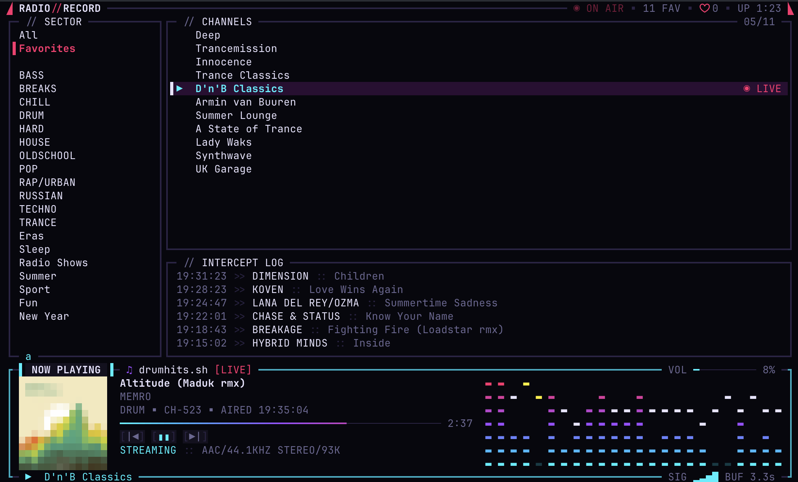

<h1 align="center">◢ RADIO//RECORD ◣</h1>

<p align="center">
  <strong>A keyboard-only cyberpunk radio player for the terminal.</strong><br>
  100+ <a href="https://www.radiorecord.ru/">Radio Record</a> stations, a live spectrum visualizer, and a vault for the songs you catch on air.
</p>

<p align="center">
  <a href="https://github.com/isalikov/radio-record-cli/releases"></a>
  <a href="https://github.com/isalikov/radio-record-cli/actions/workflows/release.yml"></a>
  
  
</p>

<p align="center">
  
</p>

<p align="center">
  <a href="#quick-start">Quick start</a> ·
  <a href="#features">Features</a> ·
  <a href="#keyboard">Keyboard</a> ·
  <a href="#liked-songs">Liked songs</a> ·
  <a href="#configuration">Configuration</a> ·
  <a href="#troubleshooting">Troubleshooting</a> ·
  <a href="#support">Support</a>
</p>

## Quick start

```sh
curl -fsSL https://raw.githubusercontent.com/isalikov/radio-record-cli/master/scripts/install.sh | sh
radio-record
```

Pick a station with the arrows and press Enter. Press `l` when a song you like
comes on, `v` to see every song you saved, and `?` for all keys.

## Features

| | |
| --- | --- |
| **Every station** | The full Radio Record catalog, grouped by genre, with favorites on `f`. |
| **Native audio** | A built-in AAC decoder plays through CoreAudio or ALSA. No ffmpeg, mpv, or VLC. |
| **Spectrum visualizer** | 96 frequency bands from a real FFT of the audio you hear, with falling peak caps. |
| **Now playing** | Cover art (pixel art, or real images on kitty, sixel, and iTerm2), track progress, stream format. |
| **Track vault** | `l` saves the song on air. The vault links each song to YouTube Music, Spotify, Yandex Music, and Apple Music. |
| **Track history** | The INTERCEPT LOG shows what the station played before. |
| **Account sync** | Sign in to sync favorite stations with your Radio Record account. |
| **Media keys** | F7/F8/F9 everywhere; on macOS, the system play/pause and track keys too. |
| **Themes and motion** | NEON-77, amber, phosphor, and paper themes; `NO_COLOR`; three motion levels. |

The screen is a HUD: a status line on top, then framed panels for categories
(SECTOR), stations (CHANNELS), and recent tracks (INTERCEPT LOG), and a NOW
PLAYING window with cover art and the visualizer at the bottom. Neon cyan marks
playback; neon magenta marks the selected category, favorites, and live badges;
acid yellow marks buffering and faults.

## Install

Once release archives are published, users can install with one command:

```sh
curl -fsSL https://raw.githubusercontent.com/isalikov/radio-record-cli/master/scripts/install.sh | sh
```

The script downloads the latest GitHub Release for the current macOS or Linux
architecture. If no release archive exists yet, it falls back to `cargo install`
from this repository, so the same command also works for local development
machines that already have Rust installed.

Installed binaries go to `~/.local/bin/radio-record` by default. If that directory is
not in `PATH`, add it once in your shell profile.

The binary uses CoreAudio on macOS and the ALSA runtime library on Linux.
HTTP, TLS, and AAC decoding are built in.

## Uninstall

```sh
curl -fsSL https://raw.githubusercontent.com/isalikov/radio-record-cli/master/scripts/uninstall.sh | sh
```

This removes `~/.local/bin/radio-record` (or `$RADIO_RECORD_PREFIX/bin/radio-record` if you installed
with a custom prefix) and keeps your favorites and volume. To delete the settings too,
pass `--purge` when running the script directly, or set `RADIO_RECORD_PURGE=1` when piping
it from curl:

```sh
curl -fsSL https://raw.githubusercontent.com/isalikov/radio-record-cli/master/scripts/uninstall.sh | RADIO_RECORD_PURGE=1 sh
```

Settings live in `~/.config/radio-record` by default; the script honours the same
`RADIO_RECORD_CONFIG_DIR` and `XDG_CONFIG_HOME` overrides as the app.

## Keyboard

| Key | Action |
| --- | --- |
| Tab / Shift+Tab | Next / previous category, wrapping around |
| ↑ / ↓, j / k | Select a station without changing playback |
| Enter | Play selected station |
| F7 / F9 | Play previous / next station in the current category |
| F8 / Space | Play / pause |
| - / = | Player volume, 2% steps, 0–100% |
| f | Toggle favorite |
| l | Like / unlike the song on air |
| v | Open / close the track vault (liked songs) |
| i | Show / hide recent tracks |
| d | Toggle diagnostics overlay |
| a | Open account, sign in, sync favorites, or sign out |
| PgUp / PgDn, Home / End | Scroll stations |
| r | Refresh stations and history |
| s | Stop |
| ? / Esc | Open / close help |
| q / Ctrl+C | Quit |

Previous/next follows the playing station when it is in the current category;
otherwise it starts at the selected station. Unavailable streams are skipped.
Function transport keys also work while help is open.
Left/right arrows have no action. History is read-only. There is no station
search; the track vault has its own filter.

Favorites have a small magenta `+` outside the Favorites category. Inside Favorites,
the category itself identifies them, so the marker is hidden. Station and track
names retain their original spelling from the API; application labels are English.

Terminal F7/F8/F9 and forwarded media-key events are supported in every
engine. On macOS, radio-record registers system previous/play-pause/next controls
during playback. The hardware media keys work while radio-record
owns the active media session, including when its terminal is unfocused.
The session shows the station name and playback state and is cleared on
stop, playback failure, or exit. Fn+F7/F8/F9 sends ordinary function keys to
the terminal. No global keyboard interception is installed.

## Liked songs

Press `l` to save the song on air to the track vault; press it again to
remove it. The now-playing border briefly shows `♥ SAVED TO VAULT`, the title
gets a `♥` while the song stays liked, and the header counts liked songs.
Jingles and shows marked by the API cannot be liked (`! NOT A SONG`).
Browsing never changes which song `l` saves: it is always the one on air.

Press `v` to open the vault in place of the station browser; the status line
and now-playing panel stay. It lists artist, title, the station the song was
heard on, and when it was saved.

| Key | In the vault |
| --- | --- |
| ↑ / ↓, j / k, PgUp / PgDn, Home / End | Select a song |
| Enter | Open the song's links |
| / | Filter by artist, title, or station; Enter keeps it, Esc clears it |
| o | Sort: newest, artist, station |
| x / Delete | Delete; press again to confirm, Esc cancels |
| v / Esc | Back to stations |

The link card lists YouTube Music, Spotify, Yandex Music, Apple Music, and
the radiorecord.ru track page when the API provides one. `↑ / ↓` and Enter,
or `1`–`5`, open a link in the default browser (`open` on macOS, `xdg-open`
on Linux); `c` copies the selected link through the terminal clipboard
(OSC 52, ignored by terminals without it, such as Terminal.app); `a` opens
all; `x` deletes; Esc goes back. Each row says `direct` for a link to the
track itself and `search` for a search by artist and title. Apple Music and
the Radio Record page come directly from the API. Spotify and YouTube Music
have no public anonymous lookup, so they are searches. Yandex Music starts
as a search; on like and when a card opens, the player asks the unofficial
Yandex Music search API for a direct link (`searching…`) and keeps it only
when artist and title match. Failed lookups are retried the next time the
card opens. Search text drops bracketed tags such as `(Record Mix)`.

Volume, play/pause, stop, `l`, and quit keep working in the vault and card.
Liked songs are stored locally in `settings.json` and are not synced to the
Radio Record account.

## Account and favorites sync

Press `a` to open your Radio Record account. Enter your email and password,
use Tab to move between fields, then Enter to sign in. Pasting is supported;
the password is masked and never saved. Esc closes the window and clears the
password. F7/F8/F9 and media keys still control playback while it is open.

The account window shows your name, email, Premium status, and sync status.
`s` (or Enter) syncs favorites now; `l` signs out after confirmation and lets
you switch accounts. Signing out keeps local favorites. Editing personal
information, registration, and password recovery remain on the Radio Record
website.

Favorites sync in the background on startup, 750 ms after local changes settle,
and every 30 seconds while signed in. Changes on only one side apply
automatically. On first sign-in when the lists differ, or when both sides have
changed since the last successful sync, a dialog offers three choices:

- **Merge both** preserves independent additions. With a previous sync baseline,
  it also honors deletions from either side; on first sign-in it keeps the union.
- **Use local on both** replaces server favorites with the local list.
- **Use server on both** replaces local favorites with the server list.

Use arrows or Tab to select, or 1/2/3, then Enter to apply. The dialog previews
station counts and additions/removals on each side. Esc defers the decision;
`a` reopens it. No replacement happens until you choose. A new server change
while reviewing causes the lists to be checked again before writing. Local
edits made during a request are kept for the next sync.

Only favorite **stations** are synced; favorite tracks and podcasts are untouched.
Network failures leave local favorites and the last successful baseline intact.
The sidebar shows `a <email>` while signed in and `a Account` otherwise.
A trailing `!` marks account issues; open the window to see the error and retry
with `s`. Offline playback and local favorites remain available.

The device session and per-account sync baseline are stored in `account.json`
next to `settings.json`, with owner-only permissions on Unix. Signing out removes
that file. Cookies and passwords are not stored. `RADIO_RECORD_CONFIG_DIR` and
`XDG_CONFIG_HOME` apply to both files.

## Configuration

| Variable | Values | Effect |
| --- | --- | --- |
| `RADIO_RECORD_THEME` | `default`, `amber`, `phosphor`, `paper` | Color theme |
| `RADIO_RECORD_FX` | `full`, `calm`, `off` | How much the interface moves |
| `RADIO_RECORD_COVER` | `pixel`, `sharp` | Pixel-art or real cover images |
| `RADIO_RECORD_CONFIG_DIR` | path | Where settings are stored |
| `RADIO_RECORD_BASE_URL` | URL | API base, for development |
| `NO_COLOR` | any non-empty value | Disables colors; wins over the theme |

Minimum terminal size: 44 × 12. History is hidden in
short windows to leave room for stations. Truecolor terminals show the full palette.
Windows at least 21 rows tall show the now-playing panel; 31 rows and more
give it a larger cover, a metadata line, and a separate telemetry line.
Shorter windows keep a compact footer with the visualizer above the status
line. The top line shows the playback state (`◉ ON AIR`, `◉ SYNC 42%`,
`▮▮ HOLD`, `! FAULT`, or `○ STANDBY`), the favorite station count, the
liked-song count (`♥ 3`), and uptime.

`RADIO_RECORD_COVER` selects how covers are drawn: `pixel` (default) draws
pixel art with half-block characters in any truecolor terminal; `sharp` asks
the terminal at startup for a picture protocol (kitty, sixel, or iTerm2) and
shows the real image, falling back to pixel art when none is offered or while
a popup is open. Use `sharp` only in a terminal emulator: a terminal that
never answers the query delays startup by 2 seconds and swallows the first key.
An unknown value falls back to `pixel` with a note on stderr.

`RADIO_RECORD_THEME` selects a color theme: `default` (NEON-77: neon cyan,
magenta, and violet on near-black),
`amber` (monochrome amber CRT), `phosphor` (green terminal), or `paper`
(light, for white terminals). An unknown name falls back to `default` with a
note on stderr. `NO_COLOR` disables colors and takes precedence over the theme.

`RADIO_RECORD_FX` selects how much the interface moves: `full` (default),
`calm`, or `off`. Motion that follows the audio runs in `full` and `calm`:
the visualizer's peak caps, the now-playing frame brightening with the bass,
and the `SIGNAL ACQUIRING` fill that tracks the real buffering percentage.
Decorative motion runs only in `full`: a new track's title decodes into place
over about half a second, and `◉ ON AIR` pulses once a second while playing.
`off` keeps the interface still apart from the visualizer itself. `NO_COLOR`
caps the mode at `calm`; an unknown value means `full` with a note on stderr.

## Audio and settings

Native audio uses HTTP (rustls), a pure-Rust AAC-LC decoder (Symphonia),
and a fixed-capacity ring feeding CoreAudio or ALSA. The engine preserves the
current output-device format, including sample rates below the radio stream
and mono headset outputs. On macOS it reads the hardware clock rather than
assuming the virtual stream format has the same rate. Matching rates pass
through directly; faster rates use linear interpolation; slower rates use a
low-pass filter before interpolation to suppress aliasing. Filter coefficients
are prepared before playback, and the callback allocates nothing. A mono
device receives the average of both channels. Unsupported device formats
are reported as audio-device errors.

Native pause silences output on the next callback and discards queued audio,
including the resampler's look-ahead and filter history. The reader keeps draining the radio;
resume buffers fresh audio. HLS rejoins recent published segments, so its
normal segment delay still applies.

HLS segments are fed completely as ring space becomes available; they are
not truncated to the ring's capacity. The output waits for 0.3 seconds of
audio at startup and after starvation. Its buffering percentage measures
progress toward that threshold. Cache fill, underruns, and audio levels come
from the output callback, so they follow consumption even while HTTP is idle.

Failed URLs fall through to the next supported stream, with three rounds
and a two-second delay between rounds. Each URL change resets the ring,
output sample rate, and telemetry. Stalled HLS playlists and repeated corrupt
segments trigger fallback instead of leaving playback silent indefinitely.
The `d` diagnostics overlay shows cache fill and underruns.

The visualizer shows 96 log-spaced frequency bands from 50 Hz to 14 kHz as
columns of stacked `▬` pills, bass on the left. Every 50 ms the worker runs a
4096-point FFT over the mono mix of the audio just heard, before software gain.
The output callback publishes samples through a fixed ring of atomics, so it
still never locks or allocates. The window is shifted back by the device's
reported output latency, so columns move with the sound on Bluetooth outputs
too. Each band reads FFT bins no other band reads, and each is scaled against
its own recent range blended with the station's loud moments over the last
five seconds, so mids and highs move as much as the bass. Wide panels
interpolate between bands and narrow ones keep each group's maximum; no band
is drawn twice side by side. Pills shade from cyan at the bottom through
violet to magenta at the top over a dim resting floor. Columns rise almost
instantly and fall with accelerating gravity; a cap marks each column's
recent peak, holds for 0.3 seconds, then falls slowly, glowing yellow near
the top. Nothing moves without audio. Pause, buffering, stop, and stream
changes reset it to the resting floor. Pill shape and gaps depend on the
terminal font.

The now-playing panel takes its window name from the station (`record.sh`,
or `music.sh` when stopped). Its top border carries a `[LIVE]` badge and a
ten-step volume meter; its bottom border carries the playback status and,
while loading or playing, `SIG ▂▃▅▇ BUF 2.4s`, four bars lit by how much of
the three-second ring is queued. Inside are the track cover, title and
artist, the genre, station number, and airing time on tall panels, a neon
progress bar, previous/play-pause/next keys, and the stream format
(`STREAMING :: AAC/44.1KHZ STEREO/96K`). The visualizer sits beside them at
full cover height, or below them when the panel is narrow. The keys mirror
F7/F8/F9; there is no mouse support. Live radio has no track length,
so the bar shows time since the track started on air and fills against the
median length of the station's recent tracks; it stays empty until that is
known. Covers are 200 px images from the history API, fetched once per track;
a missing cover shows a placeholder note, as does `NO_COLOR`.

Press `d` for a diagnostics overlay: player state and generation, codec, sample
rate, channels, bitrate, the active stream and its fallback round, cache fill
and underruns, worker health, history age, uptime, and a sparkline of recent
loudness (one smoothed level riding the louder channel). The built-in engine measures telemetry in-process. While a stream buffers, the status symbol
shows the real cache percentage instead of a bare dot. If the player worker
stops reporting for two seconds while audio should be alive, the footer shows
`Player engine stalled · q quit`. The warning clears when the worker resumes
reporting; each new play request starts a fresh two-second deadline.

The UI and application logic use Rust, Ratatui and Crossterm. The built-in
engine decodes AAC in-process. macOS system media controls belong to radio-record
and remain available across station changes. Volume is software gain
and does not change system volume.

Favorites, volume, and liked songs are saved atomically in `~/.config/radio-record/settings.json`.
Directory precedence: `RADIO_RECORD_CONFIG_DIR`, `$XDG_CONFIG_HOME/radio-record`,
`~/.config/radio-record`. Corrupt settings are reported rather than overwritten.

History and current track metadata refresh every 15 seconds. The API may lag
behind audio, especially after pausing. `RADIO_RECORD_BASE_URL` overrides the API
base URL for development. Requests time out after 15 seconds.
Stream priority: `stream_320`, then the AAC-LC variant of `stream_hls`. If a
stream fails to load, the player tries the next distinct supported URL before
reporting an error. The HE-AAC `stream_128` and `stream_64` entries are skipped.

## Troubleshooting

**`audio device failed · Enter to retry`** — the native output stream reported
a fatal error. Press Enter to reopen it. Brief device underruns/overruns,
automatic audio-route changes, and denied real-time scheduling do not stop
playback; a brief audio glitch may still be audible.

**`audio device error: ... Sample rate update timed out`** — CoreAudio could
not finish opening the output while the device format was changing. Press
Enter to retry. radio-record opens the current hardware rate, including lower-rate
Bluetooth call formats such as 24 kHz, and resamples radio audio to it. Mono
output mixes both channels. On macOS the hardware clock is read separately
from the virtual stream format, so a call's lower rate is preserved. Bluetooth
headphones can sound less clear while their microphone is active.

**`HE-AAC streams are unsupported · select another station`** — the station
only offers streams the built-in AAC-LC decoder cannot play. Select a station
with a direct AAC-LC stream or an AAC-LC HLS variant.

**`<host> unreachable · Enter to retry`** — the player could not open any of
the station's streams. radio-record falls back from the direct streams to HLS and
then retries the whole list two more times, 2 seconds apart, before showing
this; the message names the hosts that failed. The HLS host is a rotating DNS
pool, so a retry can land on an address that works. A VPN or split-tunnel rule
that sends some of these addresses around the tunnel is a common cause: route
`*.hostingradio.ru` and `*.magonet.ru` through the VPN, or check with
`curl -sI https://radiorecord.hostingradio.ru/rr_main96.aacp`. Other errors
are shown as `Stream unavailable: <reason>`.

## Build from source

Building from source requires Rust/Cargo. On Linux, also install the ALSA
headers and pkg-config (`sudo apt install libasound2-dev pkg-config` on
Debian/Ubuntu). Release binaries need only the ALSA runtime library
(`libasound.so.2`); macOS uses the built-in CoreAudio framework. HTTP, TLS,
and AAC decoding are compiled into the binary.

Audio uses the built-in engine: direct AAC-LC streams and the AAC-LC variant
of HLS. HE-AAC-only stations are unsupported and report a clear error.

The Rust toolchain is pinned in `mise.toml`. With [mise](https://mise.jdx.dev) installed,
`mise install` in this directory fetches the right `cargo`, `rustfmt`, and `clippy`.
Any other Rust installation (rustup, distro package) works as well.

```sh
mise install
make run
```

Plain `make` prints help.

```sh
make build
make test
make check
make test-audio
```

`make test` runs offline: stream fixtures recorded from the real streams are
decoded, and the engine pipeline is tested against a null output sink using
the same callback as the real device. Tests cover long segments, pause and
resume, stale buffers, station changes, stream fallback, and filtered downsampling. Live
checks that need the network run with
`cargo test live_ -- --ignored` (direct stream, HLS, a Yandex Music lookup, and a
short burst on the real audio device). The HLS check observes multiple segment publications
for continuity. `make test-audio` opens the current real output format with
silent audio and verifies that its hardware rate and channels remain unchanged.
Account tests use a local HTTP server for login, merge decisions, write
verification, and request failures; they need no real account.

## Support

If radio-record is useful to you, you can support its development on Ko-fi:

<p align="center">
  <a href="https://ko-fi.com/isalikov"></a>
</p>

Bug reports, station suggestions, and small improvements are welcome too.
